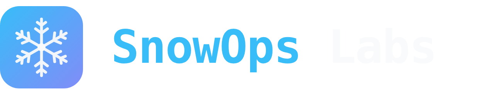
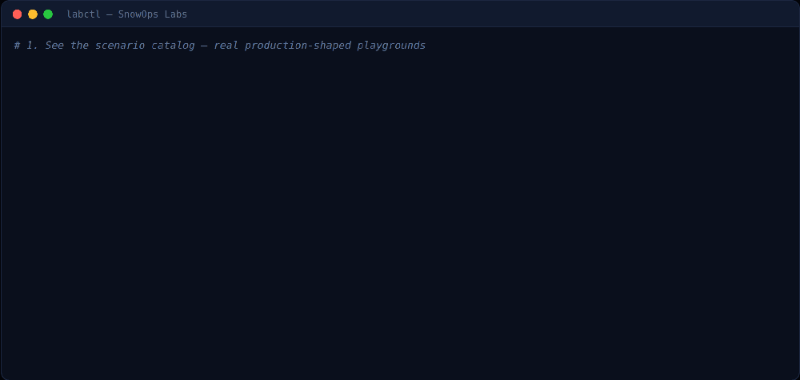
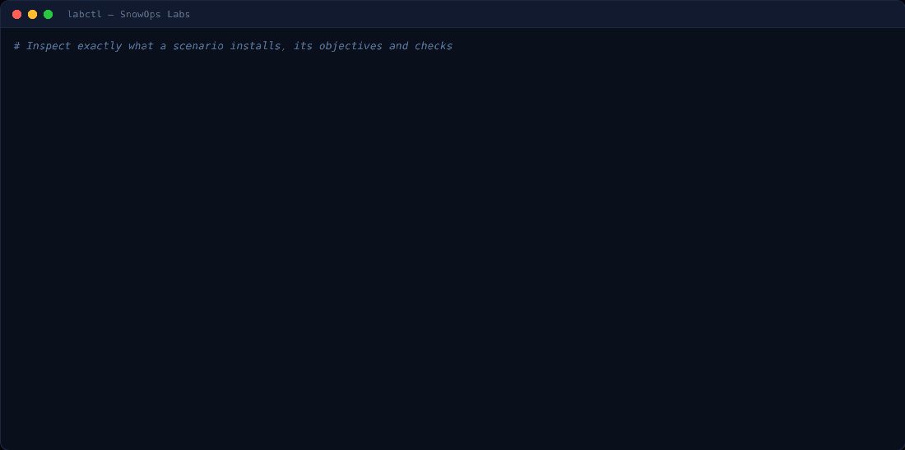
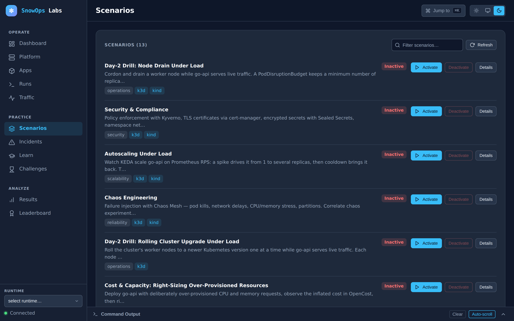
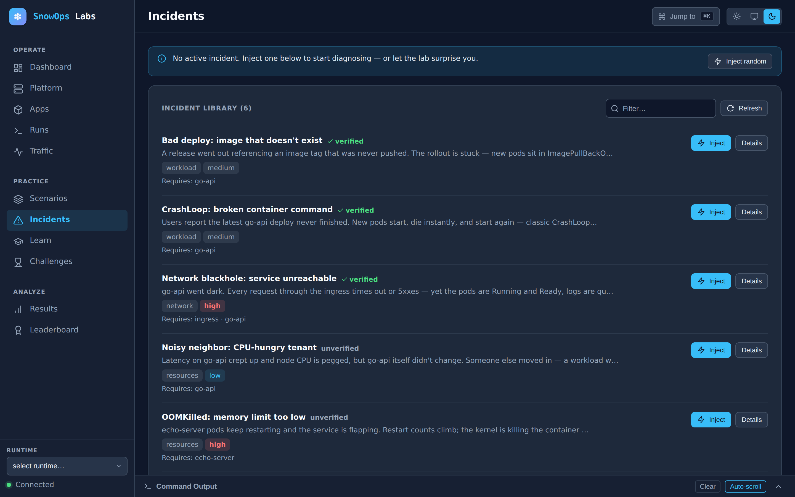
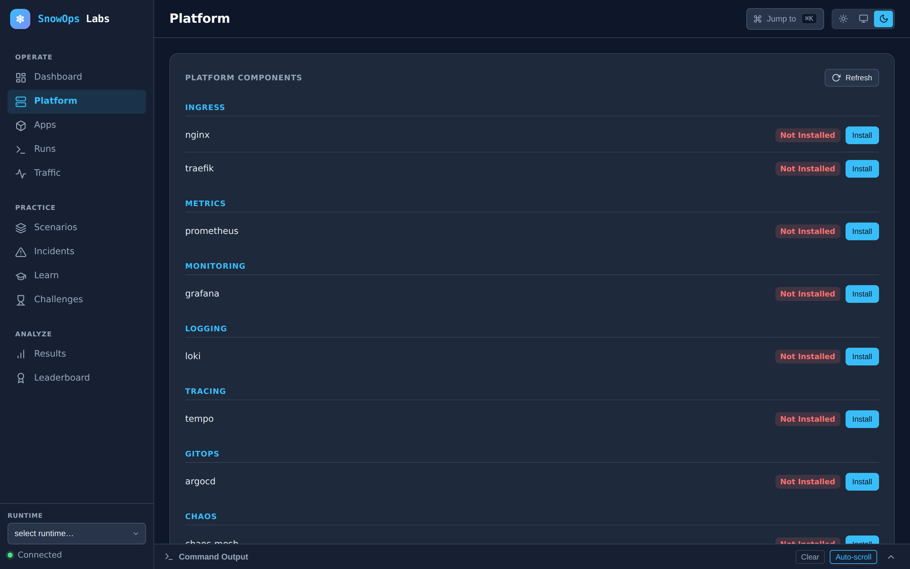
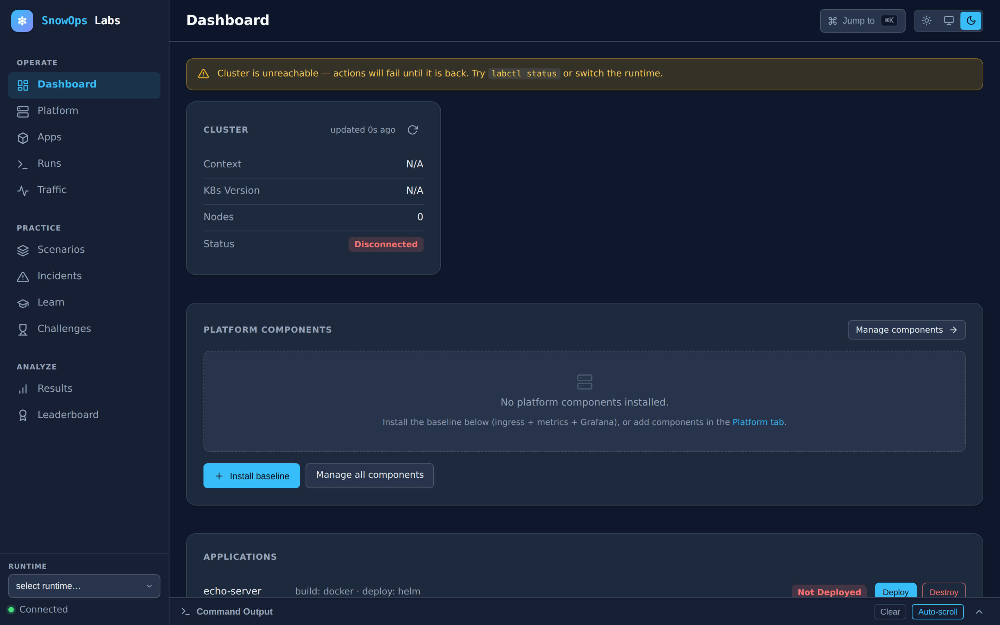

<p align="center">
  <picture>
    <source media="(prefers-color-scheme: dark)"  srcset="docs/assets/brand/logo-dark.png">
    <source media="(prefers-color-scheme: light)" srcset="docs/assets/brand/logo-light.png">
    
  </picture>
</p>

<p align="center">
  <em>A flight simulator for platform engineers: a real Kubernetes platform on your laptop, broken on purpose, with your fix graded.</em>
</p>

<p align="center">
  <a href="LICENSE"></a>
  <a href="https://github.com/sagar2395/snowopslabs/actions/workflows/ci.yaml"></a>
  <a href="https://github.com/sagar2395/snowopslabs/releases"></a>
  <a href="https://codespaces.new/sagar2395/snowopslabs/tree/stable?quickstart=1"></a>
</p>

**SnowOps Labs is a Kubernetes platform-engineering simulator.** One command
builds a production-shaped cluster on your laptop: real Prometheus, Grafana,
Loki, Tempo, Argo CD, Istio, Kafka and Vault, not mocks. Then it breaks that
cluster in ways you will meet on call, and grades how you fix it against the
live cluster.

Practise what production never lets you practise: finding why every pod is
Ready while a third of requests fail, draining a node under load without
breaking the SLO, or picking a service mesh with evidence instead of opinion.
It runs on macOS (Apple Silicon and Intel), Linux and Windows via WSL2, or in
your browser through GitHub Codespaces.

<p align="center">
  
</p>

## Try it

```bash
git clone --branch stable https://github.com/sagar2395/snowopslabs.git
cd snowopslabs && ./install.sh
labctl init                                              # cluster + platform, 5 to 10 minutes
labctl incident inject crashloop-bad-config --deploy-prereqs
labctl incident status                                   # hints, and whether you fixed it
```

No Docker on this machine? [Open it in GitHub Codespaces](https://codespaces.new/sagar2395/snowopslabs/tree/stable?quickstart=1)
and skip to [Your first lab](#your-first-lab).

**Status:** stable releases ship on the `stable` branch, with every fault
checked against a live cluster each night. What comes next is on the
[roadmap](docs/ROADMAP.md); bugs and ideas go in
[issues](https://github.com/sagar2395/snowopslabs/issues).

## The four loops

| Loop | What you do | Command |
|---|---|---|
| **Build** | Stand up a cluster and install a real platform stack from swappable providers | `labctl init` |
| **Simulate** | Activate a scenario with objectives and checks that grade your work | `labctl scenario up <name>` |
| **Break** | Inject a reversible fault while traffic flows and alerts fire | `labctl incident inject <name>` |
| **Measure** | Grade the outcome: checks passed, time to resolve, hints used | `labctl scenario verify <name>` |

Failures are injected into the real systems, so the signal you debug is the
signal you would see in production.

## Who it is for

| You are | You use it to |
|---|---|
| An engineer learning Kubernetes operations | Work through a learning path, then debug each class of failure without help |
| A platform team choosing a tool | Swap a provider, run the same scenario on both, and compare the results |
| An SRE running a game day | Inject faults, unnamed if you like, and measure time to resolve across sessions |
| A lead assessing skills | Run timed challenges with the same faults, grading and par time for everyone |

## What you can practise

Every scenario and fault below ships today and is graded by checks against
the live cluster.

**13 scenarios** ([catalog](docs/scenarios.md)):

| Area | Scenarios |
|---|---|
| Observability | `observability-sre`: wire traces through a collector, follow one request across logs, metrics and traces, fire an SLO alert |
| Scaling and cost | `autoscaling-under-load` (KEDA on Prometheus RPS) · `cost-right-sizing` (OpenCost, requests sized to measured peak) |
| Delivery | `gitops-cicd` (Argo CD against a repo you push to) · `env-promotion` (dev to staging to prod) · `mesh-traffic-management` (Istio canary, fault injection, mTLS) |
| Security | `security-compliance` (Kyverno audit to enforce, cert-manager) · `secrets-management` (Vault rotation through External Secrets) |
| Reliability | `chaos-engineering` (Chaos Mesh experiments with a hypothesis) |
| Data | `event-driven-arch` (a Kafka consumer group falling behind) |
| Day-2 operations | `node-drain-drill` · `cluster-upgrade-drill` · `backup-restore-drill`, each graded on live traffic |

**12 faults** ([library](docs/incidents.md)), for example:

| Fault | What you walk into |
|---|---|
| `dns-egress-blocked` | A security policy forgot port 53. Every pod is Ready, `/health` answers, and requests that call the upstream fail. |
| `stray-pod-behind-service` | A steady fraction of requests fails. Every pod is Ready, and the app's own error panel is flat. |
| `cpu-throttling` | p99 latency is in seconds, with no restarts, no errors and a nearly idle node. |
| `missing-secret-key` | After a credential rotation, no pod starts and there are no logs to read. |

**4 timed challenges** (`on-call-shift` lands two unnamed faults at once) and
the `kubernetes-foundations` learning path tie these together into a
curriculum.

## See it in action

Every asset below is real `labctl` output and the actual embedded UI.

**Inspect a scenario before you run it.** `labctl scenario info` shows what a
scenario installs: its stages, objectives, the checks that grade you, and
commands to explore with:

<p align="center">
  
</p>

**Drive it from a browser.** `labctl ui` serves a web dashboard at
`http://localhost:3939`, built into the same binary:

<picture>
  <source media="(prefers-color-scheme: dark)"  srcset="docs/assets/ui-scenarios.png">
  <source media="(prefers-color-scheme: light)" srcset="docs/assets/ui-scenarios-light.png">
  
</picture>

More of the dashboard (click a thumbnail for full size):

| Fault library | Platform components | Operate hub |
|---|---|---|
| [](docs/assets/ui-incidents.png) | [](docs/assets/ui-platform.png) | [](docs/assets/ui-dashboard.png) |

**Watch the setup.** A [video walkthrough on YouTube](https://www.youtube.com/watch?v=XtItNiMiQy8)
explains what the lab is and sets it up on a Mac, following the same steps
as [Install](#install).

## How it compares

| Option | What it leaves out |
|---|---|
| Browser-based labs | Small clusters with no observability stack and no realistic failures |
| Certification courses (CKA/CKAD) | They test what you know, not how you respond to an incident under time pressure |
| Internal game days | Setup costs so much that they happen once or twice a year |

## What's inside

| Layer | What it does |
|---|---|
| **Runtimes** | `k3d` (the default), `kind` (headless, used in CI), `incluster` (a shared team server) |
| **Platform** | Ingress (Traefik/Nginx), monitoring (Prometheus + Grafana), logging (Loki), tracing (Tempo), GitOps (Argo CD), mesh (Istio/Linkerd), data (Kafka/Postgres), secrets (Vault/ESO), autoscaling (KEDA), cost (OpenCost), security (Kyverno, cert-manager), chaos (Chaos Mesh) |
| **Scenarios** | Declarative labs with objectives and checks that grade your work |
| **Incidents** | Reversible production faults with progressive hints and time-to-resolve measurement |
| **Learn** | Ordered paths that chain scenarios and incidents into a curriculum |
| **Challenges** | Timed, graded runs scored on par time and hints used |
| **Apps** | `go-api` (HTTP, metrics, tracing), `java-api` (the same contract on the JVM), `echo-server` (HTTP + Redis), or [your own](docs/reference/cli/apps.md) |
| **CLI + UI** | `labctl`: one binary with the web dashboard built in |

## What you need

- **macOS, Linux, or Windows with WSL2.**
- **Docker with at least 2 CPUs and 4 GB of memory.** On macOS you don't need to
  install anything: `labctl init` installs colima (a lightweight Docker VM) with
  Homebrew and starts it at that size. Docker Desktop works too.
- **About 10 GB of free disk** for the VM, images and cluster.

`labctl init` installs everything else (`kubectl`, `helm`, `k3d`) for you,
without sudo (Homebrew on macOS, `~/.local/bin` on Linux and WSL).

2 CPU / 4 GB runs one scenario at a time, including the observability and
autoscaling ones. 4 CPU / 6 GB runs a couple together, or the heavier ones
(Kafka, service mesh, GitOps), and 8 GB runs several. Before a scenario
starts, labctl checks it fits and, if not, tells you which scenario to stop
or how to give Docker more memory. Per-scenario figures:
[Resources](docs/resources.md).

Your OS in detail: [macOS](docs/getting-started/macos.md) ·
[Linux](docs/getting-started/linux.md) ·
[Windows (WSL2)](docs/getting-started/wsl.md) ·
[GitHub Codespaces](docs/getting-started/codespaces.md).

## Install

Your lab is a clone of this repository: every manifest, Helm values file,
scenario and fault is a file you can open, read and change. Clone the latest
release anywhere you like, then run its installer:

```bash
git clone --branch stable https://github.com/sagar2395/snowopslabs.git
cd snowopslabs
./install.sh
```

`stable` always points at the latest release; to pin one, clone with
`--branch vX.Y.Z` (see [releases](https://github.com/sagar2395/snowopslabs/releases)).
`install.sh` downloads the `labctl` binary that matches your clone into
`~/.local/bin`, verifies its checksum and needs no sudo. It also records where
your clone is, so `labctl` works from any directory. If `~/.local/bin` is not
on your `PATH` yet, it prints one command that adds it to the right startup
file for your shell.

On Windows, clone inside WSL2, in your Linux home (`cd ~`), not under `/mnt/c`.

To skip installing anything,
[open the lab in GitHub Codespaces](https://codespaces.new/sagar2395/snowopslabs/tree/stable?quickstart=1).
It builds the lab in a 4-core codespace on your GitHub account with the same
`install.sh` and `labctl init` ([details](docs/getting-started/codespaces.md)).

## Your first lab

```bash
labctl init
```

`init` checks your machine, installs what is missing, starts Docker at the
right size, creates a local Kubernetes cluster and installs the platform
(Traefik, Prometheus, Grafana). The first run downloads a few hundred MB and
takes about five to ten minutes; it ends with the lab's URLs. If anything is
wrong (Docker too small, a stalled download, a pod that won't start), it stops
and says how to fix it.

Open the dashboard:

```bash
labctl ui          # http://localhost:3939
```

Run a scenario. `--deploy-prereqs` builds and deploys the app it runs against
and installs any platform component it needs:

```bash
labctl scenario list
labctl scenario info observability-sre       # what it installs, its objectives and checks
labctl scenario up observability-sre --deploy-prereqs
labctl scenario verify observability-sre     # how you're doing
labctl scenario down observability-sre       # when you're done
```

Break something and fix it:

```bash
labctl incident inject crashloop-bad-config --deploy-prereqs
labctl incident status                       # whether it is resolved
labctl incident hint                         # the next hint, when you are stuck
```

The cluster is yours: `kubectl` and `helm` work against it directly. Lab URLs
look like `http://grafana.snowops.localhost` and need no hosts-file edits.

Next: [Using the lab](docs/getting-started/using-the-lab.md) covers changing
what the lab installs, bringing it back after a reboot, upgrading,
configuration and uninstalling.

## When something goes wrong

The errors say what to do. The most common:

| You see | Do this |
|---|---|
| `docker is too small for the lab` | Resize Docker with the command printed, then `labctl init`. |
| The dashboard or `labctl status` says the cluster is unreachable | Docker or colima is stopped, usually after a reboot. Run `labctl init`. |
| `Not enough memory for <scenario>` | Run the commands it prints to free memory, or resize Docker as printed. |
| `could not find your lab` | Run `./install.sh` in your clone once, or `cd` into it. |

Everything else, by symptom: [Troubleshooting](docs/troubleshooting.md).

## Documentation

| | |
|---|---|
| [Getting started: macOS](docs/getting-started/macos.md) · [Linux](docs/getting-started/linux.md) · [WSL2](docs/getting-started/wsl.md) · [Codespaces](docs/getting-started/codespaces.md) | Installing and running on your OS, or in the browser |
| [Using the lab](docs/getting-started/using-the-lab.md) | Everyday commands, changing the lab, upgrading, configuration, uninstalling |
| [Scenario catalog](docs/scenarios.md) | Every scenario, what it teaches and what it needs |
| [Fault library](docs/incidents.md) | Every fault, what breaks and the challenges built on them |
| [Learning paths](learn/README.md) · [Challenges](challenges/README.md) | Guided modules, and timed graded runs |
| [CLI reference](docs/reference/cli/index.md) | Every `labctl` command and flag |
| [Resources](docs/resources.md) | How much CPU and memory each scenario needs |
| [Troubleshooting](docs/troubleshooting.md) | Fixes by symptom |
| [Product](docs/PRODUCT.md) · [Roadmap](docs/ROADMAP.md) | What SnowOps Labs is for, and what comes next |
| [Setup video](https://www.youtube.com/watch?v=XtItNiMiQy8) | What SnowOps Labs is and how to set it up locally, on YouTube |

## Contributing

The easiest first contribution is content: a new fault or scenario is YAML
plus a shell script, with no Go to write. Start with
[your first scenario](docs/authoring/first-scenario.md), pick up a
[good first issue](https://github.com/sagar2395/snowopslabs/labels/good%20first%20issue),
and read [CONTRIBUTING](CONTRIBUTING.md) for working on labctl itself.

## License

Apache-2.0 - see [LICENSE](LICENSE), [NOTICE](NOTICE) and
[TRADEMARKS.md](TRADEMARKS.md).
